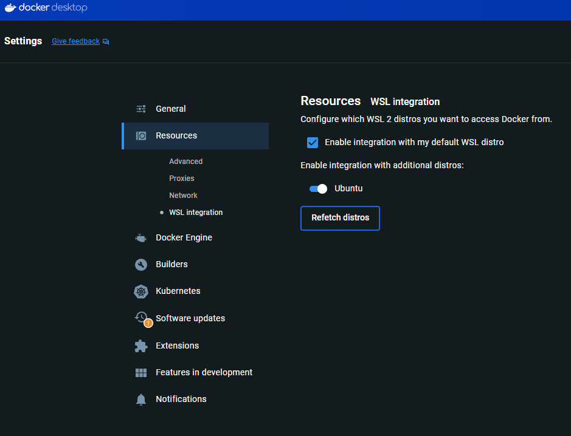

# Software Installation

Before we can begin containerizing our workflows, you will need to set up your local environment. You will need the following:

* For Windows users: [WSL installed](https://learn.microsoft.com/en-us/windows/wsl/install)
* [CONDA installed](https://github.com/conda-forge/miniforge)
* A docker Hub Account
* Docker Desktop (signed in)

## 0. WINDOWS users only install WSL

Install WSL on your computer following the instructions [here](https://learn.microsoft.com/en-us/windows/wsl/install)

You will need to launch PowerShell, then run the following command:

```
wsl --install
```

This should download the default linux image, Ubuntu. Set it up on your computer, then prompt you to create a username (default is okay), and a linux password (can be the same as your login password for Windows).  Once done, you should be in your Ubuntu Linux terminal. To test, close the window, go to your start search bar, then type "Ubuntu". This should be a program that you launch that opens a Terminal window in your WSL Linux installation.

If you have problems, please arrive early to the workshop so we can troubleshoot the installation.

## 1. Install CONDA

We need a package manager to install programs. Use the miniforge implementation of CONDA package manager. This only needs to be installed once per system.

[Miniforge CONDA Releases](https://github.com/conda-forge/miniforge/releases)

Look at the newest available assets to download listed towards the top of the page. Depending on your system, you will need to choose different packages. The commands are generalized, so be sure to type in or *tab-complete* the exact filename of the verison you downloaded when running the bash commands.

=== "Windows"
    Download **Miniforge-VERSION-Linux-x86_64.sh** with the following command from within your "Ubuntu" WSL terminal.
    (Yes, I know you are on a windows computer downloading a Linux version of the installer. This is because you are installing it on the Ubuntu WSL terminal).

    First right-click on the appropriate release, and choose **Copy Link**.
    Second, open up an Ubuntu WSL terminal and run the following command.
     
    ```
    wget PASTE_LINK_HERE
    ```

    This will download the shell script which will install CONDA. Once downloaded, use `bash` to run the shell script and perform the installation

    ```
    bash Miniforge-VERSION-Linux-x86_64.sh
    ```

    You will first need to review the license agreement. Use either the down arrow key or space bar to navigate to the bottom of the license agreement. Type **yes** to accept the agreement and start the installation process. Choose the installation location. The default location should be fine, so press **enter** here. Next, you will notice files being downloaded. Once complete, it'll ask you if you would like it to perform the initialization. Type **yes**. CONDA installation process should be complete and bring you back to the command prompt. You should also see green text which signifies it was completed successfully.  However, you will need to reload your environment to get the newly installed CONDA configurations. The easiest way is to close the terminal window, and open a new one by launching the **Ubuntu** program.  You should now see **(base)** at the beginning of your command prompt. Another way would be to source your .bashrc configuration file.

    ```
    source ~/.bashrc
    ```

=== "macOS"
    Download the arm64 installation **Miniforge-VERSION-MacOSX-arm64.sh** if you have a newer Mac with M1, M2, M3, etc class chipset
    Download the x86_64 installation **Miniforge-VERSION-MacOSX-x86_64.sh** if you have an older Intel based chipset

    First right-click on the appropriate release, and choose **Copy Link**.
    Second, open up the Terminal program and run the following command.

    ```
    curl -LO PASTE_LINK_HERE
    ```

    This will download the shell script which will install CONDA. Once downloaded, use `bash` to run the shell script and perform the installation

    ```
    bash Miniforge-VERSION-MacOSX-arm64.sh
    ```

    You will first need to review the license agreement. Use either the down arrow key or space bar to navigate to the bottom of the license agreement. Type **yes** to accept the agreement and start the installation process. Choose the installation location. The default location should be fine, so press **enter** here. Next, you will notice files being downloaded. Once complete, it'll ask you if you would like it to perform the initialization. Type **yes**. CONDA installation process should be complete and bring you back to the command prompt. You should also see green text which signifies it was completed successfully.  However, you will need to reload your environment to get the newly installed CONDA configurations. The easiest way is to close the terminal window, and open a new one by launching the **Terminal** program.  You should now see **(base)** at the beginning of your command prompt. Another way would be to source your .zshrc configuration file.

    ```
    source ~/.bashrc
    ```
  
    We use wget to download data during various workshops, which isn't included on MacOS. I suggest you use conda to install wget on your computer.

    ```
    conda install wget
    ```

=== "Linux"
    Download the x86_64 installation **Miniforge-VERSION-Linux-x86_64.sh** 

    First right-click on the appropriate release, and choose **Copy Link**.
    Second, open up the Terminal program and run the following command.

    ```
    wget PASTE_LINK_HERE
    ```

    This will download the shell script which will install CONDA. Once downloaded, use `bash` to run the shell script and perform the installation

    ```
    bash Miniforge-VERSION-Linux-x86_64.sh
    ```

    You will first need to review the license agreement. Use either the down arrow key or space bar to navigate to the bottom of the license agreement. Type **yes** to accept the agreement and start the installation process. Choose the installation location. The default location should be fine, so press **enter** here. Next, you will notice files being downloaded. Once complete, it'll ask you if you would like it to perform the initialization. Type **yes**. CONDA installation process should be complete and bring you back to the command prompt. You should also see green text which signifies it was completed successfully.  However, you will need to reload your environment to get the newly installed CONDA configurations. The easiest way is to close the terminal window, and open a new one by launching the **Terminal** program.  You should now see **(base)** at the beginning of your command prompt. Another way would be to source your .bashrc configuration file.

    ```
    source ~/.bashrc
    ```

## 2. Create a Docker Hub Account

Docker Hub is the primary registry for Docker images (think of it as GitHub, but for software containers). We will use it to pull pre-built environments and host our own.

* Navigate to [Docker Hub](https://hub.docker.com/)
* Click **Register** and create a free personal account.
* Verify your email address and save your login credentials, as you will need to log in via the command line later.

## 3. Install Docker Desktop

Docker Desktop is the easiest way to run Docker on your local machine. It includes the Docker daemon, the Docker CLI, and Docker Compose.

* Navigate to the [Get Docker](https://docs.docker.com/get-started/get-docker/) documentation.
* Download the appropriate installer for your operating system.

=== "Windows"
    Download **Docker Desktop for Windows**. Ensure you have WSL 2 (Windows Subsystem for Linux) enabled, as Docker relies on it for optimal performance.
    
    To ensure this is configured correctly, open your Docker Desktop Settings, navigate to **Resources > WSL Integration**, and make sure the integration is enabled for your default WSL distribution:
    
    

=== "macOS"
    Download **Docker Desktop for Mac**. Pay close attention to whether you are downloading the version for **Intel** chips or **Apple Silicon** (M-series chips), as they have different installers.

=== "Linux"
    Follow the repository installation instructions specific to your distribution (Ubuntu, Debian, Fedora, etc.) provided in the Docker documentation.

### Verify Your Installation

Once installed, open your terminal (or PowerShell) and run the following command to ensure Docker is responding:

```bash
docker --version
```
